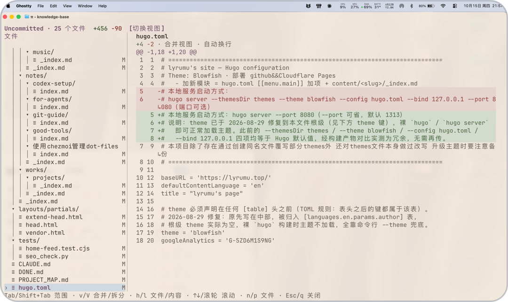
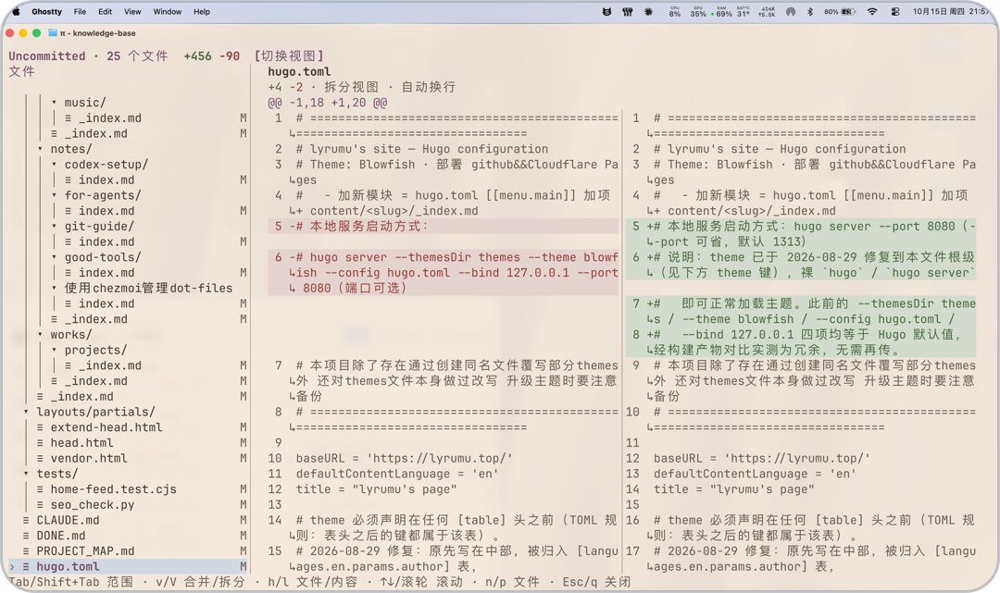

# pi-diff

[](README.md) [](README.zh-CN.md)

Review per-turn, session-wide, and Git changes in a fullscreen TUI inside [pi](https://github.com/earendil-works/pi). Browse changed files on the left and inspect diffs on the right, with mouse support, automatic line wrapping, and unified or split views.

## Features

### Unified and split views

Read additions and deletions together, or compare the old and new versions side by side. Press `v` / `V` or click the view toggle to switch layouts; your preference is saved. Long lines wrap automatically, with source line numbers preserved and both sides aligned in split view. Diff colors follow your pi theme. Added and deleted files always use unified view; narrow terminals also fall back to unified view.

<table>
  <tr>
    <th align="center">Unified view</th>
    <th align="center">Split view</th>
  </tr>
  <tr>
    <td align="center"><a href="docs/images/unified-view.png"></a></td>
    <td align="center"><a href="docs/images/split-view.png"></a></td>
  </tr>
</table>

Click a preview to view the full-size screenshot.

### Inspired by opencode

The diff viewer takes its design and core behavior from [opencode](https://github.com/anomalyco/opencode), bringing its terminal review experience into pi through `/diff`.

### Review changes without leaving pi

- **Five review scopes:** inspect the last turn, session total, unstaged changes, uncommitted changes, or all branch changes. Switch with `Tab` / `Shift+Tab`.
- **Change totals at a glance:** see the current scope's file count and total added/removed lines at the top, plus counts for the selected file.
- **Find your way through changed files:** browse a collapsible file tree with a highlighted selection and `A` / `M` / `D` markers. Use the keyboard or click and scroll with the mouse.
- **Pick up where you left off:** recorded per-turn diffs remain available after reloading pi, resuming a session, or switching session branches.
- **Read-only review:** inspect changes without staging, committing, or reverting them. Last-turn and session views also work outside Git repositories.

## Installation

Requires pi **1.2.0** (tested version), Node.js ≥ 22.19.0, npm, and Git.

```bash
# Install the extension
pi install git:github.com/lyrumu/pi-diff
```

Restart pi after installation, or enter `/reload` in a running session.

To update or uninstall:

```bash
# Update the extension
pi update git:github.com/lyrumu/pi-diff

# Uninstall the extension
pi remove git:github.com/lyrumu/pi-diff
```

## Usage

Start pi in your project directory, let it make a change, then enter `/diff`. The viewer opens **Last turn** by default.

Press `Tab` / `Shift+Tab` to cycle forward or backward through the available scopes:

| Scope | Changes shown |
|---|---|
| Last turn | Changes from the most recent task; empty if that task made no changes |
| Session total | Cumulative changes recorded on the current session branch |
| Unstaged | Index → working tree: unstaged changes |
| Uncommitted | HEAD → working tree: staged and unstaged changes |
| All branch changes | All changes since the merge base with the default base branch, including committed and uncommitted changes |

Git scopes also include untracked files. Outside a Git repository, only the first two scopes are available. The extension only reads Git state; it does not stage, commit, or revert changes.

| Action | Keyboard / mouse |
|---|---|
| Select files and collapse directories | Click; use `↑↓` in the file tree and `Enter` / Space to expand or collapse directories |
| Previous / next file | `p` / `n` |
| Focus the file tree / diff | `h` / `l`; mouse interaction focuses the corresponding pane |
| Scroll | Mouse wheel, `↑↓`, `PageUp` / `PageDown`; `Home` / `End` in the diff pane |
| Switch unified / split view | `v` / `V`, or click the view toggle at the top |
| Close | `Esc` / `q` |

File markers indicate modified (`M`), added (`A`), and deleted (`D`) files. Added and deleted files always use unified view. The diff pane also uses unified view when it is less than 100 columns wide. In narrow terminals, use `h` / `l` to switch between the file tree and diff pages.

Long lines wrap automatically. Source line numbers appear only on the first visual row, and continuation rows use `↳`. Split views keep both sides aligned. Added and removed lines use theme colors, and your layout preference is saved.

## Data and limitations

- Only changes made after the extension is enabled are recorded, within the project directory. Missing history from older sessions is not recovered.
- Per-turn diffs are saved with the pi session and remain available after reloading, resuming, or switching session branches. Content caches and layout preferences are stored in `~/.pi/agent/data/pi-diff/`.
- Outside Git repositories, shell changes may lack the original content and show `baseline unknown`. Missing cumulative caches are explicitly marked as incomplete.
- Binary files and diffs exceeding the 10 MB limit show a notice instead of their contents. Very narrow terminals may clip content.

## License

[MIT](LICENSE). Parts of the implementation are ported from [opencode](https://github.com/anomalyco/opencode). See [NOTICE.md](NOTICE.md) and [third-party licenses](THIRD_PARTY_LICENSES.md) for attribution and license terms.
